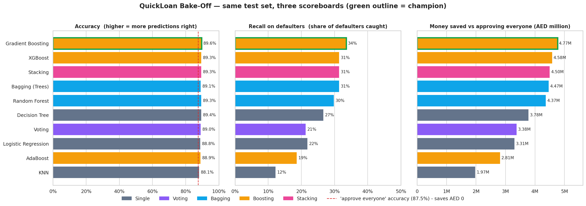

# 💰 QuickLoan — The Great Model Bake-Off

Predicting loan defaults with **ensemble learning** (Voting, Bagging, Boosting, Stacking) and choosing the model by **money saved**, not accuracy — plus an interactive **Streamlit dashboard**.

🔗 **Live dashboard:** _add your Streamlit URL here after deploying_

## The idea
QuickLoan approves or rejects small personal loans. Approving someone who defaults loses the **whole loan**; rejecting a good customer only loses the **~20 % interest**. So catching defaulters matters far more than overall accuracy. Every model is scored on the same 1,500-loan test set with the same payoff logic:

`money saved = (loans of defaulters correctly rejected) − 0.20 × (loans of good customers wrongly rejected)`

## Results (test set, default 0.5 decision rule)
| Model | Family | Accuracy | Recall (defaulters caught) | Money saved (AED) |
|---|---|---|---|---|
| Gradient Boosting | Boosting | 89.60% | 33.5% | 4,768,240 |
| XGBoost | Boosting | 89.33% | 31.4% | 4,580,800 |
| Stacking | Stacking | 89.33% | 31.4% | 4,499,140 |
| Bagging (Trees) | Bagging | 89.07% | 31.4% | 4,466,960 |
| Random Forest | Bagging | 89.33% | 29.8% | 4,368,200 |
| Decision Tree | Single | 89.40% | 26.6% | 3,782,120 |
| Voting | Voting | 89.00% | 21.3% | 3,376,260 |
| Logistic Regression | Single | 88.80% | 21.8% | 3,307,300 |
| AdaBoost | Boosting | 88.87% | 18.6% | 2,814,220 |
| KNN | Single | 88.13% | 12.2% | 1,972,840 |



**Key insight:** accuracy varies by only **1.5 points** across the ten models, but money saved varies **2.4×**. Approving everyone already scores 87.5 % accuracy while saving nothing.

**Verdict:** deploy **Gradient Boosting**. It also won 15-fold cross-validation, and re-running it with a **cost-matched cut-off** (reject if P(default) ≥ 1/6 = 0.20 / 1.20) lifts the saving from AED 4.77 M to **AED 5.82 M** (+22 %). Full reasoning and trade-offs: [Verdict.md](Verdict.md).

## The dashboard (`app.py`)
1. **Loan decision** — enter an applicant's details → APPROVE / REJECT with the default probability.
2. **Money saved** — runs the chosen model over the held-out test set: AED saved vs approving everyone, defaulters caught, good customers wrongly rejected.
3. **Leaderboard** — all ten models side by side.

A sidebar switch selects the **recommended cost-matched model** or the **bake-off champion (0.5 rule)**.
Try this applicant to see the two rules disagree: age 35, income 90,000, **loan 100,000**, 36 months, 4 years employed, 60 months credit history, **3 existing loans**, 0 past defaults, rent → default probability ≈ 28 %: *rejected* by the 1/6 rule, *approved* by the 0.5 rule.

## Run it locally
```bash
git clone https://github.com/<your-username>/<your-repo>.git
cd <your-repo>
python -m venv .venv && source .venv/bin/activate        # Windows: .venv\Scripts\activate
pip install -r requirements.txt
streamlit run app.py
```

## Deploy on Streamlit Community Cloud (free)
1. Push this repo to GitHub (public, or private with Streamlit given access).
2. Go to [share.streamlit.io](https://share.streamlit.io) → sign in with GitHub → **Create app**.
3. Choose your repository, branch `main`, main file path **`app.py`**.
4. Open **Advanced settings** and select **Python 3.12** (the version the model files were built and tested with).
5. Click **Deploy**. The first build takes a couple of minutes.

## Repository contents
| File | Purpose |
|---|---|
| `app.py` | Streamlit dashboard |
| `loan_model_costaware.joblib` | Gradient Boosting + cost-matched 1/6 cut-off (recommended) |
| `loan_model.joblib` | Gradient Boosting, default 0.5 rule (bake-off champion) |
| `loans.csv` | Dataset (6,000 loans, 12.55 % defaults) |
| `QuickLoan_Notebook.ipynb` | Full pipeline with outputs: singles → 4 ensembles → leaderboard → cross-validation → verdict |
| `leaderboard.csv`, `leaderboard_chart.png` | Leaderboard (accuracy, recall, money saved) |
| `leaderboard_cost_aware_threshold.csv`, `cv_robustness_table.csv`, `cv_money_chart.png` | Supporting evidence |
| `Verdict.md` | Recommendation to leadership |
| `requirements.txt` | Dashboard dependencies (pinned) |
| `requirements-notebook.txt` | Extra packages to re-run the notebook |

## Reproduce the models
```bash
pip install -r requirements-notebook.txt
jupyter nbconvert --to notebook --execute --inplace QuickLoan_Notebook.ipynb   # ~8 min; regenerates the .joblib files
```
All random seeds are fixed, so results are reproducible.

## Notes & limitations
- `scikit-learn`, `numpy` and `pandas` are pinned because a pickled scikit-learn model can fail to load on a different scikit-learn version. If you upgrade them, re-run the notebook to regenerate the `.joblib` files.
- One 6,000-loan classroom dataset; a single test split has only 188 defaulters, so close rankings among the top models are within noise (see the cross-validation section in the notebook). No hyper-parameter tuning was done.
- Educational project — not a production credit-scoring system.
